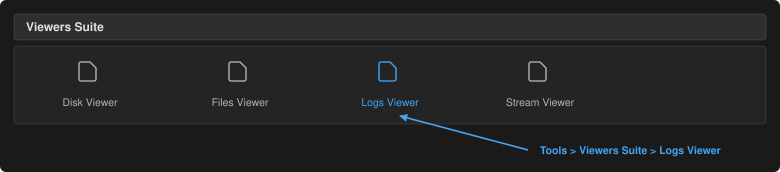
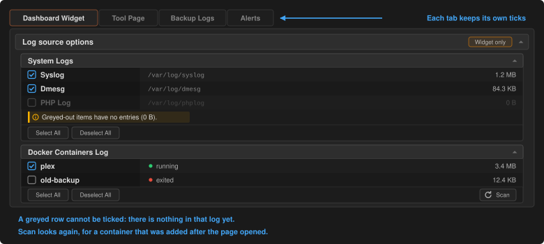
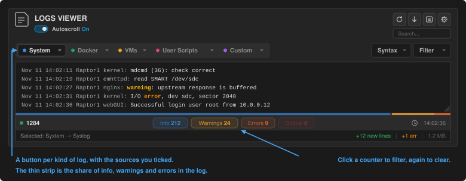
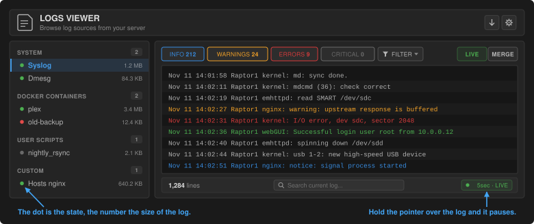
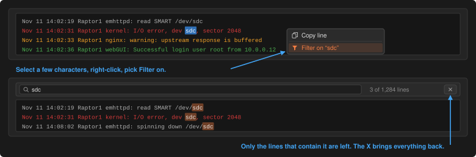
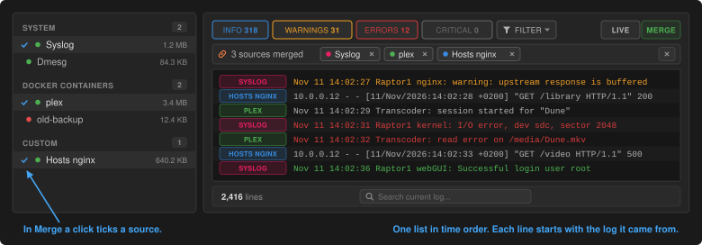
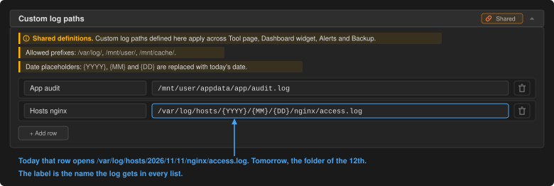
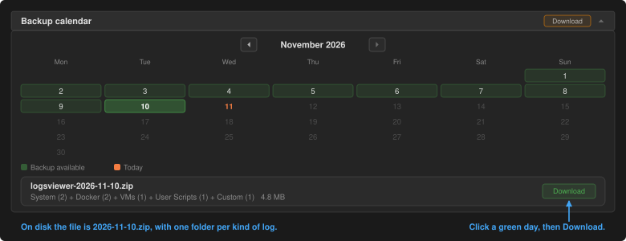
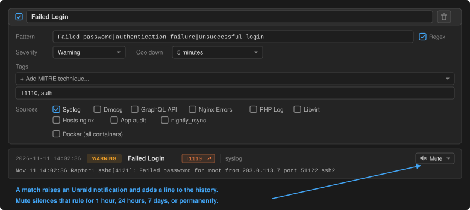

# Logs Viewer, a short guide

Logs Viewer shows your logs in two places, a widget on the Dashboard and a full
page under Tools. It can also back them up on a schedule and tell you when a
line you care about turns up. This walks through the parts that are not obvious
the first time.

## Finding it

**Tools > Viewers Suite > Logs Viewer** is the full page.

The widget needs no finding, it is on the Dashboard once the plugin is
installed. The list icon in its header opens the full page and the cog opens
the settings.

Settings live separately, under **Settings > Logs Viewer Settings**, in four
tabs: Dashboard Widget, Tool Page, Backup Logs and Alerts. Each tab is a stack
of sections, click a heading to open it. Nothing is saved until you press
**Apply**, which stays grey until something on the page differs from what is
saved. **Reset to Defaults** only touches the tab you are on, and it waits
for Apply too. It unticks the sources of that tab as well, leaving only the
four default system logs on the Dashboard and Tool tabs. Custom log paths are
not removed.

## Choosing what shows up

This is the one thing worth reading. The plugin shows a log only where you
ticked it, and every place keeps its own list. The widget, the Tools page and
the backups each have one, and an alert rule picks its sources for itself. So a
container you tick for the Tools page stays off the Dashboard until you tick it
there as well.

The lists are in the settings: **Log source options** on the Dashboard Widget
and Tool Page tabs, **Backup sources** on the Backup Logs tab. Inside are five
cards: System Logs, Docker Containers Log, VM Logs, User Scripts and Custom
Logs. Tick what you want and press Apply.

Out of the box the widget and the Tools page show Syslog, Dmesg, GraphQL API
and Nginx Errors, and nothing else is ticked anywhere.

A greyed row is a system log, a container or a VM that has written nothing
yet. It cannot be ticked, there is nothing to show. A row you ticked earlier
keeps its tick when its log is empty again, a VM that has not started since
the reboot for instance. User scripts and custom logs can be ticked ahead of
time, and their rows say "no log yet" or "not found" until the file turns up.

A greyed row that says "unsupported name" is a VM, a script folder or a
container whose name the settings file cannot hold: one with a comma, a double
quote, `<`, `>`, a slash, a backslash, `${` or an HTML entity such as `&amp;`
in it, or a container name longer than 64 characters. Rename it and the row
can be ticked. Any other name works as it is, brackets, `+`, `&` and
non-Latin letters included.

**Scan** on the Docker and VM cards reads the list again, for a container or a
VM created while the page was open. A card with nothing to list says so: no
containers, no VMs, or no User Scripts plugin. While Docker or the VM service
is not running, as with the array stopped, the card says that instead and the
containers and VMs you ticked stay ticked.

The seven system logs are fixed files:

| Name | File |
|------|------|
| Syslog | `/var/log/syslog` |
| Syslog Previous | `/boot/logs/syslog-previous` |
| Dmesg | `/var/log/dmesg` |
| GraphQL API | `/var/log/graphql-api.log` |
| Nginx Errors | `/var/log/nginx/error.log` |
| PHP Log | `/var/log/phplog` |
| Libvirt | `/var/log/libvirt/libvirtd.log` |

Syslog Previous is the syslog from before the last reboot, when Unraid kept a
copy on the flash drive. It is there for reading only, backups and alerts do
not offer it.

A container's log is what `docker logs` prints for it. A VM's log is
`/var/log/libvirt/qemu/<name>.log`.

## The widget

One log at a time, with a button for each kind of log across the top. Click a
button and it lists the sources you ticked, with a green or red dot on
containers, VMs and scripts for running or not. A button only appears once
something is ticked in its kind, and the widget opens on the first source it
has. With nothing ticked at all it shows an empty System button.

Only the log on screen is read from the server. Another one is read when you
pick it. The dots show how things stood when the Dashboard was opened, and the
dot of the source on screen keeps up with it.

Docker and the VM service get five seconds to answer. When one of them takes
longer, the Dashboard and the Tools page come up anyway, with no green dot on
its containers or VMs, and a container log that could not be fetched reads
"Docker did not answer in time." until a refresh gets it.

The header has the **Autoscroll** switch, which keeps the view at the newest
line, and four icons: refresh now, export, open the full page, settings. The
switch is remembered in that browser.

Under the log, the number on the left is how many lines the log has. The four
counters say how many of its lines are info, warnings, errors and critical,
and the thin strip above them shows the same as proportions. Click a counter
to see only those lines, click it again to see everything. The counters keep
their numbers while you do. The clock on the right is the time of the last
refresh.

The **Filter** menu does the same as the counters and adds **Login**, which
keeps the lines about signing in: auth, login, logout, token and the like.

The line at the very bottom tells you what is open, for example "Selected:
System → Syslog". On its right it reports what changed since the last refresh,
such as "+12 new lines" or "+1 err", and the size of the log. When someone
signs in to the server, or fails to, it says so for a few seconds with the
user and the address. That comes from the syslog, so it only works while
Syslog is ticked for the widget.

Three things are off until you turn them on in the Dashboard Widget tab:

- **Search in log** puts a search box in the header. It does not hide
  anything. It counts the matches, Enter jumps to the next one, Shift+Enter to
  the previous, and Escape clears the box. **Highlight search matches** marks
  them in the text.
- **Syntax highlighting** adds a **Syntax** menu with Bash/Shell, JSON, YAML,
  JavaScript and PHP, for a log that is really one of those. The choice is
  remembered in that browser.
- **Pause on hover** holds the view still while the pointer is over the log,
  so a line does not slide away as you read it.

The log panel can be made taller: drag its bottom right corner. The height is
remembered in that browser too.

The widget refreshes by itself, every 10 seconds unless you set another
interval from 3 to 60. It stops while its browser tab is in the background
and while the tile is collapsed or closed, and catches up the moment you come
back. Automatic refresh can be switched off as well, the refresh icon still
works.

**Export** saves the log as it is loaded, as `.log`, `.txt` or `.json`. The
JSON splits each line into timestamp, level and message, with the host and the
service when the line has them.

## How a line gets its level

There is no magic, the plugin looks for words. It checks critical first, then
error, warning and info, and the first that fits decides. A line with none of
the words has no level and is not counted.

| Level | Words |
|-------|-------|
| Critical | emerg, emergency, crit, critical, alert, fatal, panic |
| Error | error, err |
| Warning | warning, warn |
| Info | info, notice |

Only whole words count, in capitals or not, so "errors" or "failed" do not
make a line an error. Both pages use the same words. The Tools page has one
more colour, green, for a line that says "successful login" or "successful
logout", and it does not count that line as info.

In the widget the words themselves are coloured. On the Tools page the whole
line takes the colour of its level.

The counting covers the lines that are loaded, not the whole file.

## The Tools page

The same logs with room to read. The sidebar lists what you ticked for the
Tools page, grouped by kind, and the first one opens by itself. Each row has a
dot and the size of the log. Green means running, or simply there for a system
or custom log. Red is a container or VM that is not running, grey a script
that is idle. A system log that is still empty is left out.

**Info**, **Warnings**, **Errors** and **Critical** above the log are counters
and buttons at once. Click one to see only that level, click it again to see
everything. The **Filter** menu next to them works by threshold instead: Info
and above, Warning and above, Error and Critical. Info and above is the way to
hide the lines that have no level.

The bar under the log has the line count for the whole file, a search box and
the refresh indicator. Typing in the search box keeps only the lines that
contain the text, with the matches marked. It does not care about capitals.

The indicator reads "5sec · LIVE" while the page refreshes, every 3, 5, 10 or
20 seconds as set in the Tool Page tab. Move the pointer over the log and it
changes to "paused": nothing moves while you read, scroll or select. Take the
pointer away and the view goes back to the newest line and follows it again.
On a touch screen a finger does the same: touch the log to hold it, touch
anywhere else to let it go. A drag that ends outside the log, with the
scrollbar or a selection, keeps it held until you move the pointer away. Like
the widget, the page rests while its browser tab is in the background.

Three switches on the Tool Page tab change this. They belong to the Tools page
alone, the widget has its own.

- **Automatic refresh** off: a log is read when you pick it, and again when
  you press **Refresh now**, an icon that appears next to the download button.
  The indicator reads "auto-refresh off".
- **Autoscroll** off: the view never moves by itself. New lines are added
  below and you scroll down to them.
- **Pause on hover** off: the pointer does not hold the view. With Autoscroll
  on, a scroll up then lasts until the next refresh.

Right-click a line for two more tools. **Copy line** copies the line, or just
the part you selected. **Filter on** needs a selection: select a few
characters first, a disk name or an address, and it keeps only the lines that
contain them. A bar above the log then says how many lines are left, and its X
brings the rest back.

The arrow at the top right of the page saves the lines that are loaded,
filtered or not, as plain text, JSON or CSV. The format is set in the Tool
Page tab. JSON and CSV carry the level of each line, and a line without one is
written as info. In the CSV, a line that starts with `=`, `+`, `-` or `@` gets
an apostrophe in front, so that a spreadsheet shows it as text and does not
run it as a formula.

## Merge

**Merge** puts several logs in one list, in time order, to see what the
server, a container and an application were doing at the same moment.

Press **Merge**, then click the sources in the sidebar. Each click adds or
removes one, and the ones in the list get a tick. Two is the minimum for it to
make sense. The chosen sources are lined up above the log, each with an X to
drop it.

Every line starts with a label naming the log it came from. The order comes
from the time written in each line, and the plugin reads the usual shapes:
`Nov 11 14:02:27`, `2026-11-11 14:02:27`, `2026/11/11 14:02:27` and the
`[11/Nov/2026:14:02:27 +0200]` of web server logs. Docker lines get the time
Docker recorded for them, shown in the server's time zone. A line with no time
it can read goes to the top.

The merged list is a snapshot. It is built when you change the selection and
does not refresh, so press **Live** and **Merge** again for a fresh one, or
**Refresh now** when Automatic refresh is off. The level buttons and the
search box work in Live only. Each source brings the same lines it would show
on its own.

## Custom logs

Any log file can be added, as long as it lives under `/var/log/`,
`/mnt/user/` or `/mnt/cache/`. Open **Custom log paths**, the last card of Log
source options on the Dashboard Widget or the Tool Page tab, press **Add row**
and fill in a label and a path.

The list is shared. A path added there is offered to the widget, the Tools
page, the backups and the alert rules, and it still has to be ticked in each
place where you want it.

The label is the name the log gets everywhere. It needs at least one letter or
digit from the Latin alphabet, and two labels count as the same one when their
Latin letters and digits match, whatever the capitals, punctuation or other
letters around them. A label that breaks either rule turns the row red. Change
the letters or digits of a label and it becomes a new source, to be ticked
again.

A path that starts anywhere else turns the row red too, and so does `..` in a
path. Apply refuses a red row and says which one, and it does the same for a
row that has a label but no path, or a path but no label. A row left empty is
dropped. A link that points outside the three places is not followed, the log
never appears. A file on another pool is reached through its `/mnt/user/`
path.

A path can follow the date. `{YYYY}`, `{MM}` and `{DD}` are replaced with
today's year, month and day, so
`/var/log/hosts/{YYYY}/{MM}/{DD}/nginx/access.log` opens today's file and
moves to the next one at midnight by itself. Until the new file exists the log
says "No log for today yet." The placeholders always mean today, there is no
way to open yesterday's file through them.

## User Scripts logs

If the User Scripts plugin is installed, its scripts are listed by name, with
nothing to type in. A script with no name, or with a name that is not saved as
UTF-8 text, is listed under its folder name. The log is the one User Scripts
itself keeps, and that has two consequences.

It only exists after a script ran in the background or on its schedule. A
script started with **Run Script** sends its output to the User Scripts window
and leaves no file, and Logs Viewer says exactly that while it runs.

It is kept in memory. A reboot clears it, and until the script runs again the
log reads "No log on disk."

The dot next to a script is green while it runs.

## Backups

The **Backup Logs** tab copies the logs you choose into a zip, once a day or
every few days. It is off until you enable it, and it has its own list of
sources under **Backup sources**, empty at first.

- **Storage location** is a folder under `/mnt/user/`,
  `/mnt/user/appdata/Logs-Viewer-Backup` unless you change it. Its folder
  names cannot contain a comma, a double quote, `<`, `>`, a backslash, `${`
  or an HTML entity such as `&amp;`, and none of them can be `.` or `..`.
  Apply stops and tells you when the path is not one it can keep. The first
  backup creates it, for root only. A folder that already exists keeps its
  permissions. Either way each backup file is saved for root only, so it
  cannot be opened through a share: download it from the calendar. The
  retention deletes only the plugin's own backups: a zip named after a day
  that holds nothing but the log folders described below. A folder of its
  own is still the tidy choice, because the calendar and the frequency count
  every zip in it that is named after a day.
- **Backup schedule** is the time of day: 23:59, or 00:00, 02:00, 04:00 or
  06:00.
- **Backup frequency** is every day, or every 2, 3 or 4 days, counted from
  the newest backup in the folder.
- **Retention period** is 1 to 6 months. Older backups are deleted after each
  run.

Each backup is one file named after the day, such as `2026-11-10.zip`, with a
folder for each kind of log: `system`, `docker`, `vms`, `scripts` and
`custom`. A VM log is named after the VM and a script log after the script's
folder. It holds the whole of every log, not just the part the viewer shows.
Nothing is written while the array is stopped. A container that no longer
exists is left out, and so is one whose log does not arrive within five
minutes. Every container is left out while Docker is stopped or does not
answer within ten seconds. If the backup runs twice on one day the same file
is updated, and the logs of sources you unticked in between are taken out of
it. A file that already has the day's name and is not a zip archive is left
alone: that day's backup is not written, and a line in the syslog says so.

The **Backup calendar** section shows what exists. Days with a backup are
green. Click one and its name, contents and size appear below with a
**Download** button.

A custom path with date placeholders is backed up as the file of the day the
backup runs. Leave the schedule at 23:59 for those, an early morning run would
catch a file with only a few hours in it.

## Alerts

The **Alerts** tab watches the logs for you. Enable it, choose how often it
scans, every 1, 2 or 5 minutes, and give it rules. **Add Common Rules** drops
in six ready ones: failed logins, disk errors, out of memory, kernel panics,
array errors and container crashes. **Add Rule** starts an empty one.

A rule has:

- a tick box that switches it on or off, and a name
- a **Pattern**, the text to look for. Capitals do not matter. Tick **Regex**
  to write a regular expression instead. If the expression is not valid,
  Apply stops and names the rule
- a **Severity**, Info, Warning or Critical, which sets how the notification
  is marked
- a **Cooldown**, the quiet time before the same rule may fire again for the
  same source, from none up to 24 hours
- **Tags**, optional words of your own that follow the alert into the
  history. The menu above the field adds MITRE ATT&CK technique numbers, and a
  tag like `T1110` becomes a link to its MITRE page
- **Sources**, the logs it looks in: the system logs, every custom log, every
  user script, and **Docker (all containers)**

The scanner only reads what was written since its previous pass, so turning
alerts on does not dig up old lines. In each pass a rule fires at most once
per source, on the first new line that matches, however many more follow.
From a file it takes at most 16 megabytes of new lines in one pass, whole
lines only, and carries on from there in the next.
**Docker (all containers)** looks at what each container wrote since the
previous pass, error output included, going back two scan intervals at most.
A container that has just stopped is read one last time, so the lines it
wrote on its way down are not missed. A container whose lines Docker does not
hand over within 30 seconds is skipped in that pass.

A match sends an Unraid notification, titled with the rule and the source and
carrying the line, and adds an entry to **Alert history** with the time, the
rule, the source and the line itself. When one pass raises several alerts,
each gets its own notification, listed in Unraid as Logs Viewer Alert, Logs
Viewer Alert (2) and so on.

The history is kept in memory while the server runs and is written to the
flash drive when the array stops, which a normal shutdown or reboot does on
its way down. After a power cut the entries since the last stop are missing.

**Mute** on a history entry silences that rule for 1 hour, 24 hours, 7 days or
permanently, at once and without Apply. A muted rule is skipped entirely: no
notification and no history. The same menu unmutes it. **Scan now** runs a
pass straight away, and **Clear History** empties the list after asking.

One thing to know: Reset to Defaults on this tab empties the rule list.

## Appearance

Both places follow the Unraid theme, light on White and Azure and dark on the
rest.

The widget has more to adjust, all under **Log display**: font size, font
family, background colour and seven theme presets. The four named fonts are
web fonts from Google Fonts, and without internet access the widget falls back
to the system monospace. A preset brings its own background, so picking a
background colour sets the preset back to Default.

**Highlight levels** colours the level words in the widget, and **Keywords
only** leaves notice, debug and trace plain. Under **Layout** the counters,
the line count, the clock, the Filter menu and the bottom line can each be
hidden.

The Tools page has two sizes of text, and the choice covers the sidebar as
well.

## Large logs

The viewer reads the end of a log, never all of it: the last 5000 lines at
most, and for a file no more than its last megabyte. **Show only last N
lines**, under Performance on both tabs, brings that down to 200, 500, 800 or
1500. The counters, the filters and the search work on those lines.

The line count is for the whole file where it can be: always on the Tools
page, and in the widget while no filter is on and the full log is shown. On a
very large log it is worked out a piece at a time in the background, so for
the first moments you may see the number of loaded lines before the real total
takes its place.

Syntax highlighting is the slow part. With a syntax chosen the widget keeps to
the last 800 lines and says so in the bottom line.

## What it reads and what it writes

Logs Viewer only reads logs. It never edits, trims or deletes one, and it
cannot open anything outside the sources listed above.

What it writes is small:

- Settings, custom paths, alert rules and mutes go to
  `/boot/config/plugins/logsviewer/` on the flash drive. That happens when you
  press Apply with something changed, and when you mute a rule.
- The alert history is saved to the same folder, but only when the array
  stops and when you clear it. An alert that fires does not touch the flash
  drive.
- Working files go to `/tmp/logsviewer_cache`, which is in memory and starts
  empty after a reboot. That is why the alert scanner starts from the end of
  each log after a reboot.
- Backups go to the folder you chose.

Removing the plugin leaves the settings and the backups where they are.
